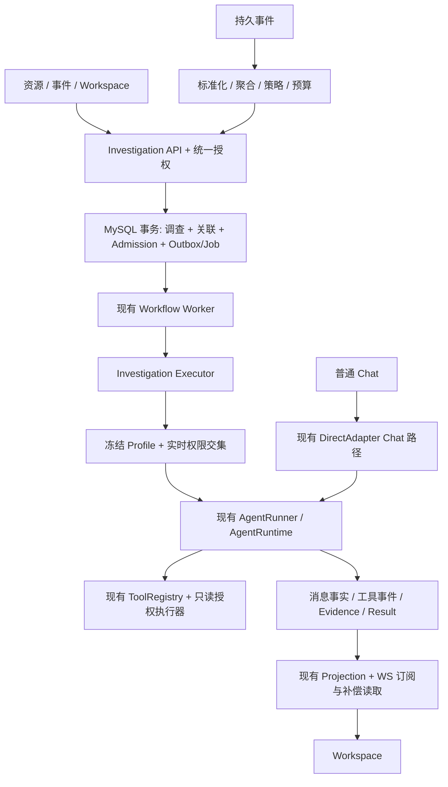
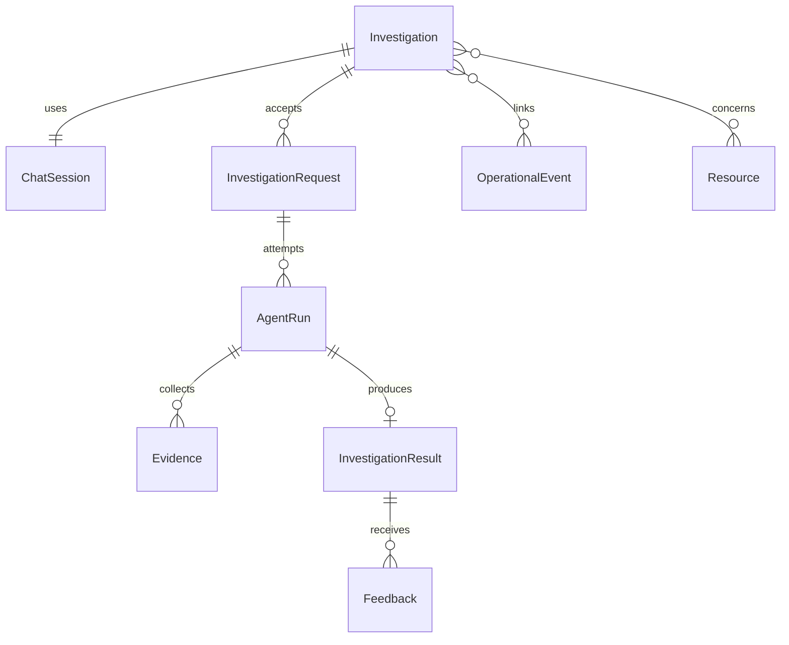

# Slide AI-Native Operations：合理性评估与完整实施方案

> **Execution:** V1 实施基线 v1.1。按主任务阶段、Review 对齐矩阵和子任务验收执行；保留现有能力，V2/V3 仅为未来设计。原型为演示数据，不能作为真实业务验收证据。

**Goal:** 在保留现有运维能力的基础上，建立可持续追问、证据可追溯、后台可靠执行且权限受控的 Investigation 工作体系。

**Architecture:** 新增轻量调查业务层，复用 Lit、Chat 消息、Message Projection、Agent Runtime、Workflow、Analysis 证据绑定与源码版本能力。普通对话保留原执行路径；调查使用统一的持久化任务入口，前端仅观察事实。

**Tech Stack:** Lit 3.3、Vite、Fastify、TypeScript、MySQL、@slide/agent-core、DirectAdapter WS。

**版本 / 日期：** 实施基线 v1.1 / 2026-10-11（Asia/Shanghai）。

**需求来源：** `/Users/max/Library/Mobile Documents/iCloud~md~obsidian/Documents/Obsidian Vault/39-Slide/02-设计/202610111800-Slide 产品演进方向与 AI-Native Operations 建设需求.md`，已完整阅读。

**代码基线：** `/Users/max/Coding/40-Slide`，HEAD `fb0766d6`。参考近期合并 #142 源码错误分类、#141 Provider 字段对齐，以及工作区现有实现。执行前对齐最新默认分支并保留工作区已有修改，原代码基线仅供追溯。

**证据边界：** 本次是关键链路源码审计及原型验证，不是全仓运行验收。未启动业务后端、未访问生产数据库、未执行真实模型/告警/源码同步链路；“已有实现”不等于“在当前部署验证通过”。

**实施范围：** 只读调查 V1、兼容迁移、PR/CI/合并与隔离环境验收。排除 V2/V3 实现、生产部署和生产变更；未设置硬预算，80–118 人日仅为规划估算。

---

## 1. 评估结论

建议采纳报告的方向，以“有条件通过”的方式进入方案评审。它正确地区分了业务问题、调查、会话、执行和证据，也明确保护现有运行时及人工控制边界。最有价值的变化是让用户可以接着调查，而不是不断生成孤立报告。

但原文不是可以直接排期的工程规格。首期实际包含跨模块数据模型、执行身份、可靠后台工具调用、消息投影、事件摄入、证据治理与兼容迁移；仅更换 Chat 外壳无法达到目标。V1 应按多个可独立发布的里程碑交付，避免把“统一入口”误判为已经统一执行体系。

### 1.1 值得保留的判断

| 报告主张 | 评估 | 实施解释 |
|---|---|---|
| Investigation 为核心对象 | 合理 | 引入稳定业务 ID，连续多次 Run 共享调查目标和上下文 |
| AI Anywhere | 合理 | 资源、事件页面传入规范上下文，返回同一个 Investigation ID |
| Evidence First | 必须保留 | 数据来源绑定、引用权限与结论正确性分别判定 |
| Human in Control | 必须保留 | V1 只读；LLM 无权授予自身工具、资源或变更权限 |
| 复用运行时和消息能力 | 合理 | 扩展入口、授权和持久化关联，不重新造 Chat/Agent 内核 |
| 运行中不修改目标 | 合理 | V1 只允许观察与取消；新输入须等本次执行终止 |
| V2/V3 延后 | 合理 | 图谱、自主多 Agent、预测、自动修复不进入首期 |

### 1.2 必须修正或补齐

1. **后台 Analysis 不等于自主工具调查。** 当前 `runInvoke()` 只开放 analysis completion 工具；需要新增受限调查执行入口，而不能把现有 `invoke()` 开放为管理员工具通道。
2. **平台观测不是持久事件存储。** 当前结构化日志为进程内一小时缓冲，容量 10,000；System Agent 需要可靠事件与引用存储，不能依赖进程仍然存活。
3. **自动身份是首期阻塞依赖。** ActorContext、会话归属与当前后台无浏览器身份路径不对称，必须先定义受限服务主体和调查级授权。
4. **结果未知必须有明确 UI 和恢复语义。** 模型请求发送后失联，不能自动重放付费请求、猜测成功或把“Worker 完成”当作“调查有结论”。
5. **证据绑定不能叫“根因已验证”。** `verification=bound` 只说明引用关联到冻结快照；新增独立 root-cause verification 与业务恢复字段。
6. **“推理展示”改成“可审计执行摘要”。** 展示公开阶段摘要、工具事实和证据，不承诺输出模型内部思维链。
7. **V1 的关注事项只作确定性聚合视图。** 不建设独立 Attention 状态机；按严重程度、持续时间、影响资源与待处理状态排序，不声称主动预测。
8. **质量验证前移。** 基础标注样本、负面证据、拒绝猜测与越权测试应在首个试点建立，不能等 Phase 4 才开始。
9. **只读同样需要资源限额。** 禁止 EXPLAIN ANALYZE 等可能真实执行重查询的操作；普通 EXPLAIN、日志查询和指标查询也要超时、行数和时间窗口上限。
10. **完整 V1 保留三类资源自动触发。** 可以先以数据库试点，但不能将数据库试点当作报告要求的完整 V1。

### 1.3 三种路线比较

| 路线 | 收益 | 代价 / 风险 | 建议 |
|---|---|---|---|
| A. Chat 增加调查外壳，复用可靠执行基础 | 改动集中，兼容成本可控，可阶段发布 | 必须解决服务主体、后台工具与消息落库衔接 | **采用** |
| B. 新建独立 Investigation 服务、会话和执行栈 | 初期边界看似整齐 | 两套消息/状态/权限/恢复体系，迁移风险最大 | 不采用 |
| C. 保留业务分析，只统一展示结果 | 最快得到一致列表 | 无法持续追问，仍是孤立报告；长期需再改 | 仅作旧数据兼容视图 |

---

## 2. 现状与需求差距（源码依据）

以下路径均相对于 `/Users/max/Coding/40-Slide/`。

| 能力 | 现有依据 | 可复用部分 | 必须新增 / 扩展 |
|---|---|---|---|
| Chat 双向交互与持久 Run | `apps/db-ops-api/src/adapter/direct-adapter.ts`；`adapter/agent-run-service.ts` | `chat.send`、session lock、active Runs、completion staging | 持久调查 Run 脱离浏览器、后台取消与订阅授权 |
| 会话与消息权限 | `apps/db-ops-api/src/chat-database-service.ts` | MySQL chat_sessions/chat_messages、owner/read share、全局消息序列 | 调查服务会话的明确 append 授权；禁止使用 maintenance API 绕过 |
| Message Parts / Projection | `apps/db-ops-api/src/adapter/message-projection.ts`；`frontend/src/app/ui/chat/` | 工具和消息表达、恢复展示 | Investigation 元信息与后端持久事件游标 |
| 模型执行预算与超时 | `packages/agent-core/src/runtime/agent-runtime.ts` | finite budgets、deadline、AbortSignal | admission 全局预算、按 profile 快照的总成本控制 |
| Analysis 调度 | `apps/db-ops-api/src/analysis/analysis-dispatch-store.ts`；`analysis-dispatch-handler.ts` | 事务、去重锁、outbox、attempt、lease/fence、未知结果保护 | 不可原样接入持续 Session；其 sessionKey 当前按 analysis ID 追加后缀 |
| 后台 invoke | `apps/db-ops-api/src/adapter/direct-adapter.ts:1294` 起 | AgentRunner、后台 timeout、checkpoint | 当前没有诊断工具链，且与用户 Chat 身份隔离，需要受控新入口 |
| Workflow | `apps/db-ops-api/src/workflows/worker-runtime.ts`；`register-workflow-handlers.ts` | MySQL jobs、lease/fencing、retry、dead letter、cancel | `investigation.execute` handler、取消意图及发送后恢复协议 |
| 结构化结果与证据 | `apps/db-ops-api/src/analysis/analysis-envelope.ts`；`analysis-evidence.ts` | envelope、hypotheses、快照哈希、脱敏、provenance | V2 envelope 适配系统主体、claim→evidence 链接、结果版本 |
| 资源规范 | `apps/db-ops-api/src/resources/types.ts` | instance/server/network_device、关系类型及观测质量 | 系统主体使用另一条 discriminated union 分支，不伪造资源 ID |
| 平台可观测 | `apps/db-ops-api/src/platform/platform-observation-service.ts`；`structured-log-evidence-adapter.ts` | request correlation、runtime/queue/collector 观测、质量缺口 | 持久 Event、稳定错误码、堆栈指纹与隔离故障记录 |
| 源码版本访问 | `apps/db-ops-api/src/platform/source-management-service.ts`；`source-snapshot-service.ts`；`deployment-binding.ts` | 来源、快照、部署绑定、错误分类 | System Agent 只读查询包装、匹配部署 Commit 验证 |
| 安全与审批 | `apps/db-ops-api/src/auth/actor-context.ts`；`security/agent-tool-approval-*` | 实时授权、资源边界、审批执行体系 | Profile 权限交集、受限服务账户、调查内容 ACL |
| 现有导航与组件 | `frontend/src/app/ui/navigation.ts`；`frontend/src/app/ui/components/app-*.ts` | Chat/资源/事件/审批入口，共享组件 | Workspace 布局与调查页面组合，保留旧路由 |

### 2.1 三个不能直接套用的现有模型

- `AnalysisEnvelopeSchema` 当前 `subject` 强制为三类基础设施 ResourceRef，不能代表“Slide 平台错误”。不把系统错误硬塞成 instance=0；新增版本化 subject 类型并兼容旧 envelope。
- `AgentRunState` 当前为 `running/completed/partial/failed/cancelled/timed_out`，不存在 queued。排队属于 admission/job；UI 的“排队中”由 job 推导，不重复扩展一个 competing Run 状态机。
- `chat_sessions` 对非读取操作以 owner 为边界，read share 不授予 append。自动调查被用户打开不等于变成该用户所有，也不能赋予服务账户的全部权限。

---

## 3. 产品范围、信息架构与原型

### 3.1 产品分层

**V1 全量目标：** 普通对话、手动调查、两类预置 Agent、系统和三类资源告警自动调查、多 Run 继续追问、取消、历史、基础证据/假设/结论、去重、限额、权限、人工处理结果记录。

**V2：** 在已有关系和指标能力上增加可信历史案例检索、经过校准的基线、跨事件关联及知识审核。未经验证的推断不进入“可信知识”。

**V3：** 计划版本绑定审批、独立执行器、前置条件检查、执行效果验证。具体产品范围由 V1/V2 使用数据再决定；本计划为 V3 给出架构与评审门槛，不提前承诺所有高风险工具。

### 3.2 导航与布局

- 全局保留资源、事件、SQL、任务、报表、审批、审计和设置。原型只展开此次变化的页面，不表示删除未展示模块。
- 工作空间包含“关注事项”“AI 工作空间”“普通对话”。关注事项可选为首页，不强制更改现有用户默认首页。
- Workspace 是“调查导航 / 执行协作 / 证据成果”三块。全局导航在窄屏压缩，防止出现四栏挤压。
- ≥1440px 三块展开；约 1024px 右侧改抽屉；<768px 调查列表收为横向/抽屉导航，详情单栏，证据通过独立按钮打开。
- 普通对话隐藏调查面板，不填表即可提问；转为调查要求目标和必要资源边界，不重新复制历史消息。
- 运行中禁止提交新目标，允许观察与取消；输入草稿可保留，但不会偷偷排队为另一轮执行。

### 3.3 必须可见的三个状态

| 层次 | 示例 | 谁可以改变 |
|---|---|---|
| 本次执行 | 排队、运行、完成、取消、失败、超时、结果未知 | 后端调度/运行时事实 |
| 调查进度 | 开放、等待处理、已关闭、归档 | 确定性规则 + 授权人工操作 |
| 业务问题 | 未确认、处理中、已验证恢复、不适用 | 业务事件状态与人工验证记录；不会从 Run 完成自动推导 |

UI 的“调查中”是开放调查上有活动 job/Run 的投影。新 Run 完成但证据不足时显示“等待处理 / 根因待验证”，不显示“问题已解决”。

### 3.4 原型交付清单

主文件：`/Users/max/Coding/40-Slide/outputs/2026-10-11-ai-workspace/prototype.html`。单文件、无外部依赖，双击即可打开；源文件与截图在同目录。

| 画面 | 评审目的 | 覆盖阶段 |
|---|---|---|
| 关注事项 | 优先级、已有事件聚合、待人工决策 | V1 简版 |
| 调查工作空间 | 过程、工具、多个 Run、取消、三层状态 | V1 |
| 证据详情 / 假设 / 结论 | 事实与推断区分、正反证据、缺口 | V1 |
| System Agent | 日志、任务、源码版本缺口 | V1 |
| 普通对话及转调查 | 保留低门槛交互与历史关联 | V1 |
| 资源与事件中心 | 复用同一调查，避免重复分析 | V1 |
| 预置调查策略 | 来源、身份、去重、预算边界 | V1 |
| 行动与验证 | 审批绑定与效果核验 | 明确标注 V3 预览 |
| 窄屏 / 断连 / 未知 / 无权限 | 故障和响应式交互 | V1 |

原型全部使用演示数据；页面状态内存保存，刷新重置，模型输出为固定示例。原型不是正式业务实现，也不证明后端可靠性或权限已经实现。主要评审目标是信息架构、密度、操作顺序与用户理解。

---

## 4. 目标架构及运行链路



### 4.1 手动 / 自动调查统一执行入口

1. API 验证身份、目标、ResourceRef、时间范围、Profile 版本和 Idempotency-Key。
2. 同一 MySQL 事务内创建或关联调查、固定 Session、记录用户请求、生成 admission 与 job；提交后返回 202。不得“先返回接受、后尝试入队”。
3. Worker claim job，取得 lease/fencing token；重新校验授权、Profile/策略版本、预算与资源存活状态。
4. Worker 创建现有 `agent_runs` 中的运行实例，关联 admission 与 investigation；调用新增 `executeInvestigation(spec)`。它组合既有 Runtime 与工具安全层，不复制 TurnLoop。
5. 每个模型调用前持久化发送意图；每个工具调用前实时授权、限制参数并登记 invocation ID。只能读 profile 白名单与主体授权交集。
6. 消息、工具结果摘要和结构化证据落库；输出端复用 Message Parts/Projection，后台是否有人订阅不影响执行。
7. Run terminal 与结果完成记录经事务落库后才发布最终完成事件。前端“生成完毕”不能当作持久化成功。
8. 用户追问生成新 admission/Run，复用同一个调查 Session；旧结果版本不覆盖。

### 4.2 执行服务边界

新增 `investigations/executor.ts` 调用现有运行时；`DirectAdapter` 新增受限委托方法，WS 只做请求分发和观察。允许为复用抽取已触达的安全执行组合，但不搬迁全部 DirectAdapter，不大改普通 Chat 协议。

不直接修改现有 `invoke()` 的“无浏览器身份、有限工具”合同。旧 Analysis 按原路径运行；新调查走明确受限入口。这样旧调用者不会突然获得运维工具权限。

Workflow 负责 admission 的 durable delivery、claim 与重试；Agent Runtime 负责模型/工具执行。它们通过 ID、fence 和取消信号关联，不形成互相驱动的循环状态机。

---

## 5. 数据模型与生命周期

### 5.1 新增业务表（名称为实施目标）

| 表 | 核心字段 | 约束 / 索引 |
|---|---|---|
| `investigations` | id(UUID)、title、goal、profile_id/version、session_id、owner_kind、owner_id、scope_version、lifecycle、problem_status、version、created_at/updated_at | session_id 唯一；索引 owner/lifecycle/updated_at/id；乐观锁 version |
| `investigation_resources` | investigation_id、resource_type、resource_id、role | 三列唯一；复用 ResourceRef 类型；系统调查可以零资源 |
| `investigation_members` | investigation_id、user_id、role(viewer/operator)、granted_by、expires_at | 联合唯一；资源权限仍须实时校验 |
| `investigation_requests` | id、investigation_id、actor_kind/id、idempotency_key、request_hash、message_id、job_id、cancel_requested_at、created_at | unique(actor_kind,actor_id,idempotency_key)；输入 hash 不同拒绝复用 |
| `investigation_run_links` | request_id、agent_run_id、attempt_no、fencing_token、profile_snapshot_id、resolution | request/attempt 唯一；只存关联与恢复原因，不复制 Run state |
| `investigation_evidence` | id、investigation_id、run_id、tool_invocation_id、kind、source_ref、subject_json、observed_from/to、collected_at、expires_at、quality、summary、blob_ref、content_hash、scope_json | 快照不可变；所有权明确；索引 investigation/run；原始数据有上限 |
| `investigation_results` | id、investigation_id、run_id、result_version、schema_version、payload、created_at | investigation/result_version 唯一；保留历次结论 |
| `investigation_feedback` | id、result_id、actor_id、kind、comment、verification_refs、created_at | 追加记录，不覆写 AI 结果；根因确认有证据引用 |
| `operational_events` | id、source、source_event_id、kind、subject_json、occurred_at、received_at、severity、fingerprint、correlation_id、release_id、commit_sha、origin、payload_ref | unique(source,source_event_id)；fingerprint/occurred_at 索引 |
| `investigation_event_links` | investigation_id、event_id、linked_at | 联合唯一；事件计数不因重投增加 |
| `investigation_trigger_keys` | policy_id/version、scope_hash、fingerprint、active_investigation_id、window_started_at、cooldown_until | 聚合键唯一；事务行锁防并发重复创建 |
| `investigation_stream_events` | sequence、investigation_id、run_id、type、payload/ref、created_at | 单调 durable sequence；investigation/sequence 索引；存投影操作或引用，不另复制聊天全文 |

最初 Profile 使用版本化仓库配置；`profile_snapshot_id` 指向内容哈希与服务器保存快照，可用现有配置存储或单独小表。不是可视化 Agent 平台。预算 reservation/settlement 需要持久账本，可新增 `investigation_budget_ledger`，唯一(request_id, operation_id) 防重复结算。

### 5.2 关系



V1 每个调查固定一个 Session、一个活动 admission。业务 Incident 暂不另建：已有告警/事件保持原生命周期，调查进行关联。未来 incident_id 可为空增加，不回写旧事件为虚构 Incident。

### 5.3 Session 与普通对话转换

- 用户手动调查：创建用户拥有的现有 Chat Session。普通 Chat 转调查时事务关联原 session_id，不复制消息，不改 message ID；已有活动 Run 则返回 409，等结束后转换。
- 自动调查：使用真实 numeric user ID 的受限服务主体拥有专用 Session，登录能力关闭，不允许 interactive JWT，不给予 admin 通配权限。不能使用当前 `userId=0` 直接写 owner 强约束的 Chat 表。
- 用户进入自动调查：读取经调查 ACL 授权的同一 Session 投影；继续调查以用户当前权限执行，保持服务 Session 所有权不变。
- 为服务 Session 增加 `appendInvestigationMessage(actor, investigationId, expectedVersion, message)` 窄入口：服务端核验用户 operator 权限、调查与 session 绑定、活动请求和证据 scope 后事务追加。不得调用无条件 maintenance append，也不放宽普通 Chat 的 owner 规则。
- 会话被调查引用时禁止独立硬删除；归档调查不删除消息。删除与保留期作为治理操作审计，避免产生悬空关联。

### 5.4 生命周期定义

`investigations.lifecycle = open | waiting | closed | archived`。

- 创建/继续：open；有活动 job 时 UI 显示调查中/排队中。
- Run 结束且需人工：waiting，保留 result；证据不足、失败、超时、取消也可进入 waiting，但原因分开。
- 关闭：operator 提交处理记录及问题状态。标记 resolved 必须有验证方法、时间窗口和证据引用；一般问询允许 not_applicable，不能强制伪造故障恢复。
- 重新打开：追加 reopen audit、version+1；不删除原关闭原因。
- 归档：隐藏于默认列表，仍可检索；活动 job 不允许归档。

`problem_status = unconfirmed | in_progress | resolved | not_applicable`，与告警自身恢复状态独立。

Run 复用现有六态。admission 尚未执行时没有虚构 Run。恢复无法确认模型/外部工具结果时，Run 以 `partial` 终止且 `resolution=outcome_unknown`，UI 优先显示“结果未知”；保留旧 Analysis 的 `unknown`，由兼容适配层呈现一致语义。所有消费者补充 contract tests，不把 partial 解释成成功。

---

## 6. API、事件与错误契约

### 6.1 HTTP API（新增命名空间）

| 方法 / 路径 | 输入 / 行为 | 成功返回 |
|---|---|---|
| `GET /api/investigations` | cursor、limit≤50、state、source、profile、resource、query；先授权再分页和统计 | items、nextCursor、authorizedCounts |
| `POST /api/investigations` | goal≤2000、title≤200、profileId、subject、resourceRefs≤20、from/to、sessionId 可选；要求 Idempotency-Key | 202 id、sessionId、requestId、jobId、version |
| `GET /api/investigations/:id` | 重新校验调查及内容 scope | metadata、derivedRunState、latestResult、version |
| `POST /api/investigations/:id/runs` | message、expectedVersion、Idempotency-Key；运行中拒绝 | 202 requestId；稍后关联 runId |
| `POST /api/investigations/:id/requests/:requestId/cancel` | 排队时取消 admission/job；运行时追加取消意图，权限实时检查 | 202 accepted；终态由事实接口查询 |
| `GET /api/investigations/:id/events?after=` | 持久事件重放，limit≤200 | events、nextCursor、hasMore |
| `GET /api/investigations/:id/evidence/:eid` | 校验完整证据 scope、脱敏与过期状态 | 摘要、来源、时间、快照引用；原始数据另行授权 |
| `GET /api/investigations/:id/results` | 分页历次结果 | 版本化 result |
| `POST /api/investigations/:id/feedback` | resultId、kind、comment、verificationRefs | 201 feedbackId |
| `PATCH /api/investigations/:id` | expectedVersion、lifecycle、problemStatus、verification | 200 updated/version |
| `GET /api/investigation-profiles` | 返回可用预置 Agent 与能力摘要 | 不返回完整敏感 Prompt 或凭据 |
| `GET /api/operational-events/:id/investigations` | 当前用户可见的关联调查 | 避免业务页重复调用分析 |

事件摄入优先使用内部 typed service，不开放未经认证的通用“触发 AI”公共端点。外部事件 API 放后续单独设计。

### 6.2 关键错误

- 400 `INVESTIGATION_INPUT_INVALID`：非法 subject、窗口倒置、超上限。
- 403 `INVESTIGATION_OPERATION_FORBIDDEN`：可见调查但不能操作；未知/不可见对象统一 404，避免 ID 探测。
- 409 `INVESTIGATION_ACTIVE_REQUEST` / `VERSION_CONFLICT` / `IDEMPOTENCY_PAYLOAD_MISMATCH`。
- 422 `PROFILE_SUBJECT_UNSUPPORTED`：例如 Operations Profile 不接受平台错误主体。
- 429 `INVESTIGATION_BUDGET_EXHAUSTED` / `INVESTIGATION_RATE_LIMITED`，包含 Retry-After（有可预测恢复时间时）。
- 503 `INVESTIGATION_QUEUE_UNAVAILABLE`：事务未提交，未接受任务；不得返回 202。
- 410 `EVIDENCE_EXPIRED`：对象存在且授权通过，但原始快照超保留期。保留摘要和失效原因。
- 恢复原因包括 `MODEL_OUTCOME_UNKNOWN`、`LEASE_LOST`、`AUTHORITY_REVOKED`、`SOURCE_COMMIT_MISMATCH`、`EVIDENCE_MISSING`；不能一律改成“网络错误”。

### 6.3 WS 与投影

复用 DirectAdapter WS；扩展 `investigation.watch {id, afterSequence}` 和 `investigation.unwatch`。授权成功后发送持久状态快照及其 watermark，再重放 watermark 之后事件，最后进入 live stream；实现不得在“查快照→订阅”之间漏事件。

包络：`{schemaVersion:1, sequence, investigationId, requestId?, runId?, type, occurredAt, payload}`。

事件类型：`request.accepted`、`run.started`、`parts.operation`、`evidence.added`、`result.persisted`、`run.terminal`、`investigation.changed`。Parts operation 复用原 schema，不编造第二种工具状态。

客户端按事件 sequence 去重；Parts 保留已有消息/turn/operation 标识。游标超保留窗口返回 `replay_required`，重新获取完整投影；socket 断开不取消 Run。订阅需周期重新校验授权，撤权后关闭流并清理缓存、隐藏所有由不可见证据派生的摘要。

---

## 7. Agent Profile、身份与安全

### 7.1 Profile 规范

每个版本快照包含：id/version、职责、支持 subject 类型、model scene、prompt version/hash、skill version/hash、tool allowlist、output schema、资源边界规则、预算、输出语言。模型和凭据复用现有 scene 路由，前端不能提交任意 System Prompt 或 Tool allowlist。

有效工具权限 = Profile 白名单 ∩ 主体当前权限 ∩ 调查资源边界 ∩ 当前工具策略。Prompt、模型返回字段和前端隐藏按钮都不能替代此交集。

| Profile | 允许 | 明确拒绝 |
|---|---|---|
| System Agent | 有界脱敏日志、request/job 查询、采集状态、健康信息、匹配部署版本的源码读取 | 代码写入、Shell 任意命令、环境凭据、系统配置变更 |
| Operations Agent | 资源元数据、指标窗口、只读运行状态、脱敏慢 SQL、批准的 EXPLAIN、资源关系 | DDL/DML、kill session、重启、网络配置、任意 SSH |

工具层必须限制超时、返回行数、字节数和目标 host/resource；工具描述写 readonly 不足以证明安全。数据库“只读”实现需复用 SQL boundary 和底层读取凭据。

### 7.2 自动主体

预置一个或按安全域拆分的诊断服务账户：禁交互登录、显式资源 grant、仅调查相关权限、可立即停用。Policy 选择主体，事件不选择主体；模型不可修改身份。

Admission 冻结授权版本和 scope，执行前及每次工具调用前重新解析 live grants。权限收缩、扩张或版本变化均要求重新生成授权上下文；不能让旧任务因新增管理员权限自动扩大访问。

进入 Workspace 不会改变正在执行任务的主体；用户取消/追问需要 operator 权限。后续 Run 使用用户身份，其可见上下文必须是当前权限下的证据集合，不能向模型重放服务主体已见但用户无权见的数据。

V1 对多资源调查采取保守全量可见策略：无权访问任何必需资源时，调查标题、摘要、结论与证据均不泄露。后续再设计安全的局部可见投影；不在首期实现不可靠的“只隐藏证据卡片”。

### 7.3 非可信内容边界

日志、SQL 注释、源码和历史对话视为不可信输入，只作证据，不能驱动权限/策略变化。工具输出中的提示注入不允许调用额外工具、访问其他资源或关闭审计。脱敏在持久化与发送给模型之前进行，UI 再做安全渲染；原始数据 blob 不通过可枚举公网 URL 暴露。

源码只接受部署绑定的完整 Commit，缺快照/不匹配就输出证据缺口，不降级读取仓库最新分支。已有 source sync 继续其安全与 Token 生命周期规则；本项目不重建 clone/fetch 管线。

---

## 8. 事件标准化、去重、风暴与预算

### 8.1 Event envelope

`{id,source,sourceEventId,kind,subject,occurredAt,receivedAt,severity,summary,correlationId?,releaseId?,commitSha?,origin,rawRef?,schemaVersion:1}`。

subject：`{kind:'resource',resource:ResourceRef}` 或 `{kind:'platform',component,releaseId?}`。时间存 UTC，界面按用户时区呈现；不把接收时间当作发生时间。

系统错误筛选：平台 API 5xx、持续采集/任务异常；400/401/403、输入校验、用户主动取消不触发。浏览器上报为 unverified，不可凭客户端声称“严重故障”直接触发高成本任务。5xx 也需阈值，避免单个异常无限调用模型。

### 8.2 两层去重

1. **投递幂等：** `source + source_event_id` 唯一，同一事件重投 100 次仍只有一条事实。
2. **问题聚合：** 指纹为 policy + scope + resource/component + stable error code + stack callsite + deployment version。时间不直接拼成固定桶键；事务锁定活动聚合行，以 last_seen/window 判断，避免 5 分钟边界产生两份同一问题。

已开放调查优先关联新事件，更新 last_seen/count，不自动对每个重复事件创建 Run。触发后 10 分钟 cooldown；显著严重度提升或新证据满足规则时才允许新 Run，且仍受预算。已关闭后的新异常建立新调查并引用旧案例，不静默重开旧结论。

事件聚合与 Investigation 创建、job admission 事务一致；并发锁依赖 MySQL 唯一约束和行锁，不依赖 Node 内存 Map。

### 8.3 建议初始策略（需试点校准）

| 项 | 初始值 | 行为 |
|---|---|---|
| 同源触发 | 5 分钟内 3 次持续异常；critical 可单次 | 只适用配置支持的事件 |
| 全局并发 | 4；为手动任务预留 1 | 与现有 Worker 队列隔离配额，不抢占正在运行的任务 |
| 每主体 / 每调查并发 | 2 / 1 | 同 Session 互斥 |
| 自动频率 | 安全域每小时 20 次；资源 cooldown 10 分钟 | 超限持久化 suppression reason，事件继续可查 |
| 每 Run | 120s / 20 tools / 8 provider attempts / 32k input+output tokens | 重试也计入；工具截止时间不延长总期限 |
| 自动日 Token 预算 | 安全域 1,000,000 | 先 reservation，再执行，结束结算；不是费用承诺 |
| 货币成本 | 由管理员配置上限和价格表 | 无价格/usage 则标未知，不能把未知记为零 |

达到硬预算后不启动下一轮模型/工具调用；已开始调用的结果未知时保留 reservation，人工或供应商回执核销。cached input 是 input 子集；吞吐=raw input+output，不再次加缓存量。收费按对应模型 input/cache/output 费率分别计算。

### 8.4 防递归与故障隔离

事件带 origin（user_operation/collector/workflow/investigation_engine）。由 investigation_engine 产生的失败仍入事件中心，但禁止再次自动调查。超时、模型不可用和预算耗尽采用确定性说明；不另调用 LLM 解释 LLM 故障。

持久事件写入不调用模型。数据库不可用时可采用有界本地持久 spool 与重放 idempotency；若无法写 spool，记录明确 lost-event 计数与降级告警，不承诺零丢失。平台整体停机由独立基础监控兜底，System Agent 不承担自我救援能力。

---

## 9. 可靠性、恢复与取消

| 故障时点 | 确定性处理 |
|---|---|
| admission 事务提交前 | 回滚全部，客户端带同键重试 |
| job 已接受、模型未发送 | lease 到期可安全 retry；固定 request ID |
| 模型发送意图已落库、结果未确认 | 结果未知；默认不重放付费请求，不自动续跑 |
| 工具正在读取时进程崩溃 | 已取得证据保留；未确认步骤为 unknown；只在明确 idempotent readonly 工具合同允许时重新读取并记录新采集时间 |
| worker lease 丢失 | 中止后续调用，旧 fence 无权写终态；新 owner 只做可靠性检查 |
| 最终回答已 staging，消息提交失败 | 复用 completion recover，完成持久化；不重新请求模型 |
| WS 断开 / 页面关闭 | 后台继续；重连按序列补偿 |
| 排队任务取消 | CAS 取消 job 与 admission，不创建 Run |
| 正在执行取消 | 写 cancel intent、Worker heartbeat 接收、AbortController 传播；等确认才展示 cancelled |
| 取消与完成竞态 | 事务决定先到达的可信终态；已完成不会被晚取消覆盖 |
| 凭据或资源权限撤销 | 阻止后续工具与模型请求，保留授权审计、隐藏不可见内容 |

取消是 request 范围。跨进程通过 durable intent + bounded polling/pubsub 唤醒；不能只依赖 DirectAdapter 的进程内 activeRuns Map。目标 P95 2 秒内确认取消意图，已经发送的远端操作可能晚返回，UI 应显示 cancel requested 与最终事实。

---

## 10. 证据、结果与人工反馈

Evidence 必须区分 observed window / collected at；指标无数据是 unknown，不是 0。数据库慢 SQL 默认只保留指纹与脱敏摘要；日志按 request/job 限窗口与行数。新增 schema 校验错误不可升级成可信结论。

InvestigationResult V2 结构：`summary, facts[], hypotheses[], claims[], rootCauseVerification, unresolvedQuestions[], recommendations[], problemStatus, provenance`。claim 包含 `statement, kind(fact/inference), supportingEvidenceIds[], contradictingEvidenceIds[]`。

根因验证为 `unverified / supported / human_confirmed / experimentally_verified`；“supported”不是已验证。“human_confirmed”保留确认人、时间和依据；不能伪装成机器实验验证。

结果 schemaVersion=2；旧 AnalysisEnvelope v1 原样读取。为旧结果生成只读兼容视图，不补造不存在的工具事件、证据和 confidence。模型 confidence 不直接显示为“准确率 92%”；默认展示证据覆盖、缺口及验证等级。

建议保留：事件 90 天、过程投影 30 天、调查/结构化结果 180 天、敏感原始快照 7 天（须服从现有客户保留策略）。历史结果中的过期引用仍保留 tombstone/hash/原因。清理任务按保留策略分批执行，避免误删活跃调查。

关闭调查前允许记录人工已在外部完成的操作，但不会由 V1 执行生产变更。普通咨询可按 not_applicable 关闭。知识发布仅在 V2，经去敏、审核、测试与有效期设置。

---

## 11. 兼容、迁移、灰度与回滚

1. 新表采用 additive migration，由现有 `apps/db-ops-api/src/migrations/runner.ts` 注册；正式编号在实施分支按最新序列分配。旧表只加 nullable 关联或通过独立 link 表关联。
2. 普通 Chat 路由、消息 ID、WS schema 保持；`/chat` 继续可访问。新 `/workspace` 可用 feature flag 开启，不更改用户已保存首页。
3. 旧 `ai_analysis` 结果提供 read-only legacy 标识。只有用户首次查看或明确转入时建立唯一 link；不批量把每份历史报告建成调查。
4. Legacy 转调查保留原结果引用，但创建安全的新调查 Session/continuation 边界；旧 `invoke()` 的分析 Session 不直接当成用户 Chat Session。旧文本若缺权限信息先拒绝导入，不能假定可见。
5. 告警 RCA/SQL/健康/故障诊断各入口按 feature flag 切到统一 create-or-get。**同一业务入口同一时刻只能有一个执行 owner**；shadow 模式只比较 admission 决策，不双发真实 LLM。
6. Feature flags：`workspace_enabled`、`investigation_manual_enabled`、`investigation_system_auto_enabled`、`investigation_ops_auto_enabled`、`investigation_legacy_bridge_enabled`。禁止一个总开关同时开启全部自动触发。
7. 灰度顺序：开发故障夹具 → 管理员手动 → 数据库小流量 → System 异常 → 服务器/网络 → 全量 V1。用户可选择关闭自动调查但保留事件。
8. 回滚先停新 admission，再 drain/取消活动 job；保留终态和审计，不删除新表。读界面回到旧 Chat/业务页，已迁移调查保持只读兼容入口；已执行新请求不可回退为旧链路重发。
9. 回滚演练核对 row count/hash、调查-Session 关联、无孤儿 Run、无重复模型调用；老版本程序不处理未知 job_type，路由时限制 worker claim 类型。

---

## 12. 可执行任务与依赖

工作量是规划估算，不是硬预算或交付承诺。以下为人日，包含实现与模块验证；2 名后端、1 名前端及共享 QA 是估算假设，不要求本次启动团队。首期约 80–118 人日（含集成缓冲），日历周期约 7–10 周，取决于现有测试环境、权限迁移与试点反馈。

任务实施统一步骤：先增加下表指定失败场景的 focused tests → 最小实现 → 运行对应命令并校验指定结果 → 记录 evidence → 按任务原子提交。阶段边界才运行模块测试，最终候选只运行一次完整 gate。命令中的测试文件为任务将创建的目标文件，不宣称它们现在已经存在。

### P0 / T01：契约与基线锁定（3–4 人日）

**依赖：** R00 Review 对齐及材料基线 PR 合并；未解决的问题按领域门禁管理。

**文件：** 当前方案；新增 `apps/db-ops-api/src/investigations/contracts.ts`、`contracts.test.ts`，frontend 同源生成类型使用现有 contracts 管线。

**动作：** 固定 subject union、三层状态、错误码、event envelope、profile schema、权限规则；列出当前 Chat、Analysis、server/network alert 数据生产位置；逐一跑现有相关测试建立基线。

**验收：** `pnpm --filter slide-api exec vitest run src/investigations/contracts.test.ts src/analysis/analysis-envelope.test.ts src/adapter/__tests__/agent-run-service.test.ts`。合法 resource/platform 通过；错误 subject、无依据 resolved、unknown→success 转换被拒绝；原 envelope v1 可读。交付基线结果表，既有失败须分类，不顺手整改无关项。

### P1 / T02：调查模型与事务 API（5–7 人日）

**依赖：** T01。

**新增：** `investigations/store.ts`、`routes.ts`、`store.mysql.test.ts`、`routes.test.ts`；新迁移 `migrations/*-investigations.ts`（编号由当前 migration runner 确定）。修改 `server.ts` 仅注册路由。

**动作：** 实现 5/6 节模型和 create/list/detail/patch/request admission；接现有 outbox/Workflow；同键 hash 一致返回同 ID，不同返回 409；一个 Session 只有一个活动 request。

**验收：** `pnpm --filter slide-api exec vitest run src/investigations/routes.test.ts src/investigations/store.mysql.test.ts`。100 个并发同键 admission 只有一条 request/job；故障注入事务回滚无孤儿；列表过滤先授权后 limit/count；不同版本 patch 返回 409。

### P1 / T03：Profile 与调查授权（6–8 人日）

**依赖：** T01/T02。

**新增：** `investigations/profiles.ts`、`authorization.ts`、`authorization.test.ts`、`session-bridge.ts`、`session-bridge.test.ts`。修改 `auth/actor-context.ts`、`chat-database-service.ts` 的受限入口，保留原 API 合同。

**动作：** 配置两个 profile、服务账户与 live grant、主体/资源/工具交集；显式调查 Session 追加方法；读取及缓存内容的安全 scope；普通对话转换事务。

**验收：** `pnpm --filter slide-api exec vitest run src/investigations/authorization.test.ts src/investigations/session-bridge.test.ts src/auth/chat-routes.test.ts`。viewer 不能 continue/cancel；普通 read share 不变成 append；服务主体不继承 admin；撤权后消息、证据、计数、WS 都不泄露；普通对话转换不复制消息。

### P1 / T04：持久调查执行与后台工具（8–12 人日，关键路径）

**依赖：** T02/T03。

**新增：** `investigations/executor.ts`、`workflow-handler.ts`、`executor.test.ts`、`execution-recovery.mysql.test.ts`。修改 `adapter/types.ts`、`adapter/direct-adapter.ts`、`adapter/agent-run-service.ts`、`workflows/register-workflow-handlers.ts`。

**动作：** 新 `executeInvestigation` 受限路径，复用 AgentRunner/ToolRegistry/消息事实；profile 只读工具选择；durable provider intent、fencing、取消意图、partial/unknown resolution；completion staging 恢复。不修改旧 invoke 的权限范围。

**验收：** `pnpm --filter slide-api exec vitest run src/investigations/executor.test.ts src/investigations/execution-recovery.mysql.test.ts src/adapter/__tests__/runtime-lifecycle.test.ts`。关闭浏览器任务继续；Worker 在 provider 发送前/后、tool 完成前/后、completion staging 后崩溃分别验证恢复；发送后未知不重复计费调用；取消与完成竞态终态唯一。

### P1 / T05：消息观察与证据结果（5–8 人日）

**依赖：** T04。

**新增：** `investigations/stream.ts`、`evidence-store.ts`、`result-schema.ts`、对应 test。修改既有 message projection 接入层与 analysis-envelope 兼容 reader；不破坏 v1 schema。

**动作：** durable cursor、snapshot watermark、watch/unwatch、结果版本、支持/反面证据、原始快照脱敏/过期；执行摘要替代无约束 reasoning 面板。

**验收：** `pnpm --filter slide-api exec vitest run src/investigations/stream.test.ts src/investigations/evidence-store.test.ts src/investigations/result-schema.test.ts src/analysis/analysis-evidence-binding.test.ts`。乱序/重复事件不增消息；watch 建立间隙不丢事件；重连后投影 hash 一致；v1 legacy 正常显示；bound 不变 verified；非本调查 Evidence ID 被拒绝。

### P1 / T06：Workspace 与普通对话兼容（8–11 人日）

**依赖：** T01 可先做 mock UI；真实接入依赖 T02–T05。

**新增：** `frontend/src/app/ui/views/investigations.ts`、`investigation-detail.ts`、`frontend/src/app/ui/controllers/investigations.ts`、`frontend/src/app/ui/components/investigation-context.ts`、`frontend/e2e/investigation-workspace.spec.ts`。修改 `navigation.ts` 和 `frontend/src/app/ui/app-render.ts` 的最小接入点。

**动作：** 关注事项简版、列表筛选、详情、共享 Chat parts 展示、三层状态、继续/取消、普通 Chat 转调查、响应式。使用 app-card/dialog/form-field/data-table/empty-state/badge、showToast、sharedBtnStyles；Boolean property binding；Light DOM 样式在 render 注入。

**验收：** `pnpm --filter slide-frontend exec playwright test e2e/investigation-workspace.spec.ts`。手动创建→工具过程→取消→新 Run→历史刷新；普通对话无需表单；转换不丢消息；桌面/1024/390 宽无横向溢出；未知、空、加载、错误、无权限状态与键盘焦点可用。

**阶段出口：** P1 可作为手动调查试用，但不称完整 V1。

### P2 / T07：持久事件、聚合与 admission 预算（6–9 人日）

**依赖：** T02/T03；可与后期 UI 接入分开推进。

**新增：** `investigations/event-ingest.ts`、`trigger-policy.ts`、`budget-ledger.ts`、`trigger-concurrency.mysql.test.ts`、`budget-ledger.test.ts`。

**动作：** Event envelope、两层去重、事务关联、policy version、cooldown、每资源/全局配额、origin 防循环、suppression 原因、reservation/settlement。

**验收：** `pnpm --filter slide-api exec vitest run src/investigations/trigger-concurrency.mysql.test.ts src/investigations/budget-ledger.test.ts`。10,000 条同指纹事件只创建一个开放调查/初次 request；跨窗口边界不重复；不同资源/版本不误合并；满额时事件可查、模型调用为零；重复结算不重复扣款；usage unknown 不按零计。

### P2 / T08：数据库告警试点与旧 Analysis 适配（5–7 人日）

**依赖：** T04–T07。

**新增：** `investigations/legacy-analysis-bridge.ts`、`legacy-analysis-bridge.test.ts`、`alert-bridge.test.ts`。修改 `alert-engine.ts`、`ai-analysis-database-service.ts` 及对应告警/分析入口，通过 flag 分流。

**动作：** 数据库告警优先 create-or-get；把既有 SQL/健康/故障诊断结果提供兼容链接；一次自动分析只有一个 owner。旧结果查看不隐式补跑。

**验收：** 运行上述两个 test；真实测试环境注入 CPU/慢 SQL 夹具，告警页与 Workspace 返回同一个 id，provider spy 证明只有一个请求链；禁用新 flag 后旧路径可用且不接管正在运行的新 job。

### P2 / T09：System Agent 持久异常与版本定位（6–9 人日）

**依赖：** T04/T05/T07。

**新增：** `investigations/system-event-bridge.ts`、`system-tools.ts`、`system-tools.test.ts`、`system-event-bridge.test.ts`。修改 `platform/platform-observation-service.ts`、对应 collector/workflow hooks 的事件摄入连接，不把全量日志同步塞到响应链路。

**动作：** API 5xx 与采集/任务失败记录；日志 request/job 关联；持久原始错误事实；source manifest/Commit 精确匹配；证据质量降级；引擎自身错误禁止递归触发。

**验收：** 运行新增 test 加 `src/platform/deployment-binding.test.ts src/platform/source-snapshot-service.test.ts`。进程重启原事件仍可查询；400/403 不触发；Commit 缺失/不一致时证据缺失而非读 main；Agent 故障仅入事件中心、不派生新 Run。已有源码同步链路若改动，必须执行项目规定的 POST sync→Commit 一致→manifest→重复同步端到端，不以 mock 替代。

### P2 / T10：服务器与网络告警、业务入口接入（5–7 人日）

**依赖：** T08/T09 的统一桥接契约。

**修改：** `server-alert-evaluator.ts`、`network-devices/network-device-alert-evaluator.ts`、`frontend/src/app/ui/components/instance-overview-tab.ts` 、`frontend/src/app/ui/views/server-detail.ts`、`frontend/src/app/ui/views/network-device-detail.ts`。新增 `investigations/resource-event-bridge.test.ts`、`frontend/e2e/investigation-resource-links.spec.ts`。

**动作：** 三类 ResourceRef 一致传递；指标/time window 带入；缺指标与设备不可达区分；业务页打开同一调查；旧分析入口兼容保留。

**验收：** 运行新增 backend/frontend tests。每类资源至少一个真实测试夹具，能从告警→调查→证据→追问→原资源往返；没有权限无法从深链绕过；网络无数据不会被输出为正常或设备宕机。

### P3 / T11：反馈、关闭验证、质量基线（4–6 人日）

**依赖：** T05/T06；评估样本从 T01 开始准备。

**新增：** `investigations/feedback.ts`、`feedback.test.ts`、`tests/qualification/investigation-eval.ts`、`tests/qualification/fixtures/investigations/`。

**动作：** 结果版本绑定反馈、人工处理记录、根因确认与业务恢复分开、旧引用过期、审计；构建第 13 节样本与 judge rubric。

**验收：** backend feedback focused test；评估 runner 返回带样本 ID 的逐项结果；禁止无证据关闭为 resolved；误判负反馈不自动写入可信知识；权限过期案例拒绝检索。模型评估允许随机性，但硬安全项必须全部通过。

### P3 / T12：灰度、恢复演练与最终门禁（7–10 人日）

**依赖：** T01–T11。

**新增：** `tests/qualification/investigation-rollout.ts`、`frontend/e2e/investigation-recovery.spec.ts`、部署运行手册及回滚记录。

**动作：** additive migration dry run、灰度 cohort、fault injection、指标仪表、old/new flag 回切、保留期清理、容量测试、operator 培训场景。

**验收：** 第 13/14 节全部通过并保存原始报告；真实 provider 至少完成一次两类 Agent 和三类资源调查链路，记录实际模型/Prompt/tool 版本；测试流量禁用生产变更能力。

**排期合计：** 68–98 人日任务工作量 + 12–20 人日集成/试点缓冲 = 80–118 人日。T01→T02/T03→T04→T05→自动触发/集成→T12 为关键路径。无需等 System 日志全部补齐才开始数据库试点，但完整 V1 必须包含 T09/T10。

---

## 13. 测试、验收与质量评估

### 13.1 分层门禁

| 层级 | 内容 | 何时运行 |
|---|---|---|
| 单元 / 契约 | schema、策略、权限交集、状态投影、脱敏、预算计算 | 开发每个相关任务 |
| MySQL 集成 | 事务唯一、并发行锁、fencing、outbox、迁移、权限查询 | 数据/执行模块边界 |
| Runtime 可靠性 | provider/tool 超时、取消、crash、unknown、completion recovery | T04/T05 候选 |
| 前端 E2E | 深链、普通 Chat、继续、刷新、断线、窄屏、权限失效 | UI 接入后 |
| 真实端到端 | 标准事件→admission→后台工具→持久结果→UI→追问→人工验证 | 最终 V1 候选 |
| 故障/负载 | 10k 重复事件、配额、租约丢失、混合 queue、缓存失效 | 发布门禁 |
| AI 评估 | 固定样本 + 版本记录 + 人工判定 + 实际 provider | Prompt/model/tool 相关变化 |

完整 gate 在最终候选执行：

```bash
pnpm --filter @slide/agent-core test
pnpm --filter slide-api test
pnpm --filter slide-frontend test
pnpm --filter slide-frontend typecheck
pnpm --filter slide-frontend build
pnpm --filter slide-frontend exec playwright test e2e/investigation-workspace.spec.ts e2e/investigation-resource-links.spec.ts e2e/investigation-recovery.spec.ts
pnpm contracts:check
pnpm qualification:matrix
```

测试需在隔离 MySQL/资源夹具上运行；MySQL suites 被 skip 不能视作通过。涉及权限或发布时再执行仓库规定的 `pnpm security:agent` / `pnpm release:security-gate`，不得因方案估算绕过现有门禁。既有与本次无关失败记录为独立问题，不扩张本次修复范围，也不宣称全门禁通过。

### 13.2 完整 V1 验收矩阵

| ID | 场景 | 通过证据 |
|---|---|---|
| A01 | 普通对话及旧历史不退化 | 历史消息/工具投影一致；旧 /chat 路径正常 |
| A02 | 一调查多 Run | 同一 investigation/session，两个不同 run ID 与两版结果 |
| A03 | 后台执行 | 关闭全部浏览器，后台仍保存 terminal/result |
| A04 | System 自动调查 | 持久错误→profile→日志/job/source 证据→可继续追问 |
| A05 | 三类资源自动调查 | instance/server/network_device 各一条端到端证据链 |
| A06 | 事件幂等 | 重投/并发/跨窗口，一组故障一个初次执行，无重复收费 |
| A07 | 用户取消 | 记录 request 与 ack；不把仍在执行的工具写 cancelled |
| A08 | WS 恢复 | 断线后快照/游标补齐，消息不丢不重 |
| A09 | Worker 重启 | 发送前安全重试，发送后未知不重放 |
| A10 | 权限隔离 | ID 枚举、resource 深链、WS、证据原文、搜索计数均无泄露 |
| A11 | 证据不足 | 正式结果保留 unknown，不编造引用，不强制根因 |
| A12 | 三层状态 | Run 完成不自动关闭调查或标问题解决 |
| A13 | 成本约束 | 并发/频率/Token 上限有效，unknown usage 不计零 |
| A14 | Legacy 兼容 | 不复制执行、不伪造证据，回滚路由可用 |
| A15 | 自身故障 | AI 不可用时原事件仍可查，无触发循环 |
| A16 | UI 与可访问性 | 1600/1024/390 宽、键盘、焦点、空/错/未知均验证 |
| A17 | 人工处理验证 | result version 绑定反馈，关闭需真实依据，not_applicable 可用 |
| A18 | 普通 Chat 转调查 | 原 Session 和消息 ID 保留，活动 Run 阻止转换 |

### 13.3 AI 调查评估集

首期建议 40 个带脱敏快照的固定案例：数据库 12、服务器 6、网络 6、平台错误 8、证据不足/权限拒绝/提示注入 8。覆盖正例与反例，包括高 CPU 但 QPS 无增长、采集缺失但设备正常、源码版本错误、模型输出伪造 Evidence ID。

每例标记允许事实、支持/反面证据、不可宣称结论、期望下一步。评估维度：引用有效性、事实忠实度、假设校准、工具选择、是否识别证据不足、越权、时间和成本。不仅测“有没有生成报告”。

硬门槛：越权调用=0、凭据泄露=0、伪造绑定被接受=0、把 unknown 当成功=0。试点建议软门槛：人工判断有帮助≥80%、事实级有证据支撑≥90%，与现有诊断报告盲评对比；这些是上线目标，不是已达到的结果。40 样本不足以证明低频风险为零；发布后持续采样与回归。

### 13.4 运行 SLO（提案）

指定基准环境（例如 4 vCPU、8GB、同区 MySQL、1 万调查/10 万事件）下：列表 P95<500ms、admission P95<1s（不含模型）、事件→入队 P95<5s、WS 恢复 P95<3s、取消意图确认 P95<2s。模型生成时间单列，不用固定 120s 超时伪装低延迟 SLO。

产品收益看“首次可用证据时间”“人工调查耗时”“准确/有帮助比例”“重复异常复用率”“每个有效调查成本”。在试点前后采用相似案例比较，避免用模型调用数、Agent 数或自动创建调查数作为价值指标。

---

## 14. 风险、停止条件与可观测性

| 风险 | 早期信号 | 对策 / 停止条件 |
|---|---|---|
| 后台路径绕过权限 | service actor 可调用未授权工具 | 硬阻塞发布，关闭自动 admission，保留事件 |
| 双系统重复执行 | 同一事件关联多个付费请求链 | 立即关闭该来源 flag，调查幂等缺口 |
| 消息/Run 状态错配 | completed 无 durable message/result | UI 标未知；completion repair，不再次调模型 |
| 告警风暴 | token reservation 满、queue wait 上升 | 限流、聚合、手动预留，不丢原始事件 |
| 证据过期或版本错配 | source commit 不一致 / stale metrics | 不确认根因；显示 gaps，要求补齐 |
| System Agent 自举循环 | origin=investigation 的新 admission | 拒绝触发并报警 |
| 首期范围失控 | CMDB、多 Agent、自动修复进入 P1 | 移入 V2/V3，不阻塞 V1 |
| 旧功能回归 | Chat/工具渲染/资源操作门禁失败 | 回切 UI flag，保留新数据，修复本次引入项 |

日志/trace 必带 investigationId、requestId、runId、eventId、jobId、profileVersion、actor/scopeVersion；不记录凭据、原始 SQL literal 或完整敏感 prompt。指标包含 accepted/suppressed、queue wait、duration、unknown rate、cancel latency、evidence gaps、provider attempts、tokens/cost、duplicate admission reuse。模型 usage 不可用须显式计数。

实施停止条件：用户未批准进入业务实施；硬预算耗尽；确认存在授权突破或数据损坏风险且无可逆修复；必要环境不可用时只停止依赖该环境的验证，不停止独立代码/文档工作。任何范围扩展形成 v1.1 等版本记录并保留累计资源统计。

---

## 15. V2 / V3 后续实施包与进入门槛

完整 V1 先落地，后续为有界独立项目，不作为此次首期排期隐性追加。

| 包 | 输入和实现 | 验收 / 进入门槛 | 初步工作量 |
|---|---|---|---|
| V2-A 可信案例 | 已关闭调查、人工确认、脱敏、版本化案例、资源权限过滤；先结构化/全文检索，必要时再引入向量 | 固定相似故障集 recall/precision 与人工基线；过期/越权案例无法返回；至少积累 30 个可信案例 | 10–15 人日 |
| V2-B 资源认知 | 扩展已有 ResourceRelation 与 provenance，覆盖缺口，不新建全套 CMDB | 关系可追溯、有效期生效、未知依赖不推断为事实 | 8–12 人日 |
| V2-C 行为基线 | 复用 metrics/baseline，按时段与样本质量计算；不足样本保留 unknown | 至少 2–4 周数据评估季节性、误报率；与静态阈值对比 | 10–15 人日 |
| V2-D 关注事项增强 | 多事件关联、确定性影响评分、可解释排序与历史案例引用 | 人工评审优先级提升；不增加不可控 AI 调用 | 8–12 人日 |
| V3-A 计划与审批 | action_plan(id,version,target,parametersHash,preconditions,expiry,verifier)，复用 approval-execution | 计划/参数/资源变化使审批失效；职责分离；限制在一个可验证工具试点 | 10–15 人日 |
| V3-B 受控执行 | 独立执行器 live auth、单次授权消费、幂等/未知结果、人类操作员接管 | 超时/重启不重复危险操作；不可逆明确告知；rollback 不可用时禁止伪称可回滚 | 12–18 人日 |
| V3-C 效果验证 | 预注册观察窗口/指标阈值/负面影响、前后快照、人为关闭 | 执行成功但指标未改善不能关闭问题；验证失败可升级人工 | 8–12 人日 |

V3 进入前须完成独立威胁建模、具体工具风险评审和测试环境演练。当前原型仅展示这条产品路径，不授权任何生产行动。

---

## 16. 对原报告十个关键问题的回答

| 原文问题 | 本方案回答 |
|---|---|
| Investigation 与 Session/Run | 新调查业务表；一个固定 Session、多 requests/Runs；消息不重复持久化，Run 六态复用 |
| 自动触发如何接执行 | 统一 admission→Workflow→受限 Investigation Executor；复用调度可靠性但不照搬 invoke 工具权限 |
| AI RCA 如何迁移 | 分来源 flag、create-or-get、legacy link，不双发模型，不批量重跑旧结果 |
| System Agent 运行上下文 | 持久错误事件+bounded log/job evidence+部署 Commit 源码；进程内观测仅辅助 |
| Agent Profile | 版本化预置配置+运行快照+现有 model scene，工具由服务器权限交集控制 |
| 自动任务身份 | 禁登录受限服务账户；访问者不改变身份，追问以用户授权重新执行 |
| Workspace 复用 Chat | 保留普通 Chat、Parts/Projection、Session；新增导航和调查 context，不重写 runtime |
| 状态如何管理 | 调度、Run、调查、业务问题各有 owner；UI 从事实投影，不根据自然语言推断 |
| 事件风暴 | source 幂等+指纹活动聚合+cooldown+并发/频率/Token reservation+origin 防循环 |
| 如何评估质量 | 从第一阶段准备固定标注案例；硬安全 gate+盲评+真实运行指标，版本化回归 |

## 17. 产品决定与部署参数

关注事项为可选首页；采用三块工作空间；执行、调查、业务状态分离；首期只读 V1。完整菜单见随附 menu-addendum.md。生产资源规模、保留期、自动调查实际预算、服务主体范围须在相关部署前校准，测试使用明确的隔离夹具与保守限额。

## 18. 本次交付验证记录

- 独立原型 Vite 构建通过，打包为无外部依赖的单个 HTML。
- Chromium 离线文件验证 24 项通过：筛选、三层状态、证据详情、假设反证、继续/取消/完成、断线/未知、撤权隐藏、搜索空状态、System/Network 内容、普通对话与转换、资源/事件同对象、关闭验证、策略模拟、V3 标识、键盘焦点、3 个宽度及运行异常检查。
- 13 张截图留档；详情见 `outputs/2026-10-11-ai-workspace/verification.json`。
- 未运行生产后端与业务测试；本节只证明评审原型行为，不代表第 13 节正式实施门禁已经通过。

