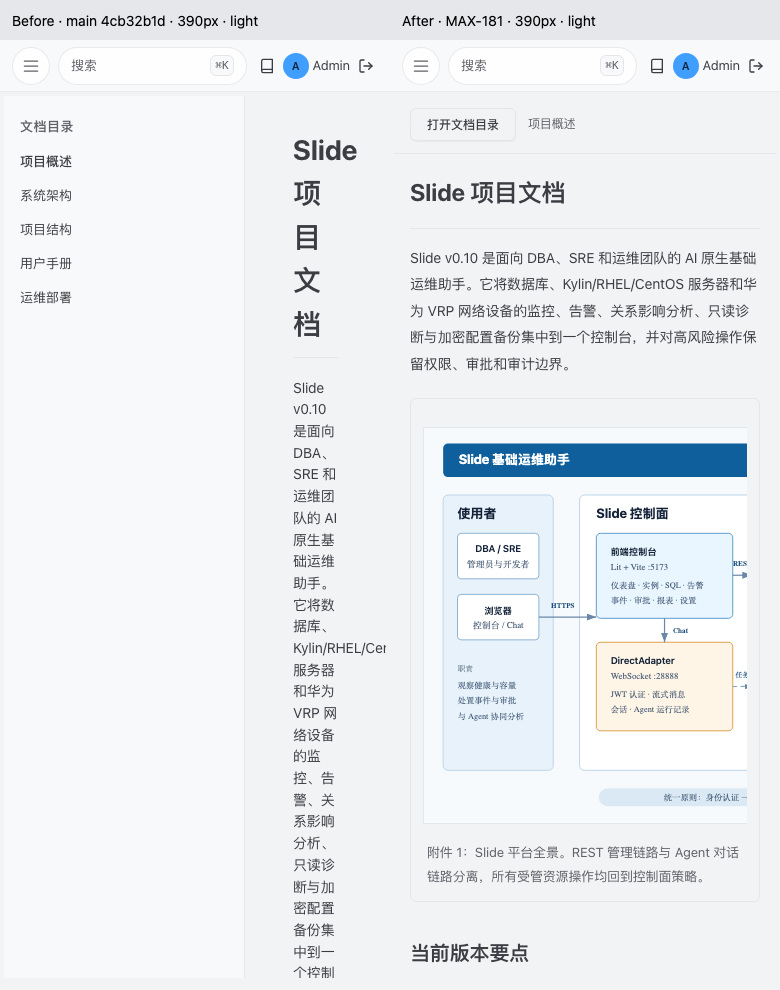

# MAX-181 文档阅读 R1.1 验收

产品提交：`35b986e715e7a48fe554918faa976d514c7da41a`。分支：`codex/MAX-181-docs-r11`。base：审定 main `4cb32b1d8596dc913a7fd2d2bbe0917e8f9520ea`。后续证据提交不修改产品字节；`validation.json` 和 `evidence/geometry.json` 记录产品 SHA256。

## 实现与范围

唯一产品改动为 `frontend/src/app/ui/views/docs-viewer.ts`。组件可用宽度 <=850px 时隐藏桌面目录，通过“打开文档目录”进入现有 app-dialog；桌面保留目录、选中态与当前文档名。正文使用 min-width:0 和 14px/1.9 行高，阅读轴线最多820px。表格、代码、文档图形分别拥有可命名、可聚焦的局部滚动区域；图形不再在手机上缩到无法辨认。

文档选择写入 URL，保持浏览器返回；会话内按文件记住阅读滚动位置。应用壳的旧 `?tab=docs` 入口在启动和返回时会归一化查询参数，本组件用 capture 阶段保存目标文档，并在壳处理后恢复；刷新回退使用 sessionStorage 中的文件名，不保存正文或认证信息。已覆盖真实顶部文档入口。请求版本避免较早响应覆盖较新选择；空列表、空内容、加载、失败及403明确区分，失败可重试。

不变更认证、权限、内容净化、共享弹窗、全局 token、导航或后端。专属 E2E 的服务启动器使用完整正式 server.ts；不新增产品端能力。

## R1.1 设计对照

批准包 SHA256：`112502a0ad6dbadc7eea35efda027ccfb079fed756bf0ed51956ac6fd71347fe`，来源为任务附件。参考图见 `reference/r11-docs-390.png` 和 `reference/r11-docs-desktop.png`。

| 对照项 | R1.1 | 实际实现与证据 |
|---|---|---|
| 窄屏目录 | 显式按钮、弹窗、Esc与焦点恢复 | 390/768 明暗 `directory-*.png`；按钮选择后关闭、焦点返回；Tab与Shift+Tab留在弹窗 |
| 正文宽度 | 占应用壳可用宽度，不硬套原型壳 | 以下实测表；`compare-*.png` 同尺寸前后图 |
| 宽内容 | 代码、表格、图形局部横滚 | 真实文档图片键盘滚动；六组 `controlled-long-*.png` 和 DOM region 几何 |
| 桌面上下文 | 目录、当前文档保持 | 1280px双主题；切换文档恢复滚动；窄屏打开目录后放大视口关闭弹窗 |
| 主题与层级 | 约24/16/14/12px与主题token | 正文14、目录/辅助13/12，标题24与现有内容层级20/16；本页未定义的旧背景变量改用已有 bg-accent |

保留真实文档标题和内容，不移植原型演示页标题/导航/状态控件。目录断点依据组件可用宽度，保证实际壳内空间不足时仍收拢。原型768px保留145px应用导航，真实壳此尺寸收起导航，因此阅读宽度不同；这是任务明确允许的壳适配。

## 同尺寸真实服务前后几何

全部视口高度950px，正常流使用同一仓库正式文档、真实登录响应/JWT与SQL实时用户校验。截图不使用受控正常响应。

| 视口 | 实际组件宽 | 改前目录 | 改前可读宽 | 改后目录 | 改后可读宽 | 整页宽 |
|---|---:|---:|---:|---:|---:|---:|
| 390 | 382 | 241 | 45 | 0 | 350 | 390 |
| 768 | 760 | 241 | 423 | 0 | 712 | 768 |
| 1280 | 1012 | 241 | 675 | 240 | 708 | 1280 |

明暗主题分别实测，结果一致。原型390px建议358px与实际350px的8px差异来自现有应用壳边距。详细 padding/clientWidth/scrollWidth/tabIndex、真实文档网络返回及浏览器异常记录见 JSON；最终137条文档响应、未捕获浏览器异常0。



同尺寸完整对照包含 `compare-390/768/1280-light/dark.png` 六张；原始截图保留在 baseline 与 evidence。baseline 对应未改动的审定 main，不能用它替代改后的业务验收。

## 验证与数据来源

- 15/15 Playwright：390/768/1280 × 明暗正常流；目录打开/选择/关闭、Esc焦点返回、刷新与浏览器返回；全部正式文档遍历；阅读位置、Tab循环、视口变化；真实顶部入口；受控晚到响应、文档链接和净化回归。
- 六组特殊状态：390/768/1280 × 明暗，每组覆盖长代码/宽表/长链接/图形、内容空、列表空、内容500、列表500、403、延迟加载及重试。此部分通过 Playwright route 控制，截图名均以 controlled 开头，不能当成实际业务故障或真实权限撤销证明。
- 正常流运行任务独有完整正式 API 与 Vite，使用独立 `slide_max181_*` MySQL schema、正式 migrations 和随机测试账号密码，经 `/api/auth/login` 取得会话。凭据仅留内存；既有测试MySQL连接值由指定环境文件加载，不保存到产物。隔离库停用迁移种子中无凭据的 Provider，避免启动被其阻塞；共享配置不受影响。
- 121个文件 / 1068项前端单测通过；前端 typecheck、生产 build、CSP（2脚本）通过；全仓 lint 0错误、253警告。未触及公开契约，契约检查不适用；后端全套及其他模块的完整CI由真实PR运行，不能替代本UI验收。
- 页面不发送产品模型、工具执行或资源采集请求；模型调用0。文档查看无独立的“部分/冲突/未知结果”业务状态，未新造此类能力；受控图中的“结果未知”文案保持原义。

## 复现与运行收尾

使用仓库声明的 pnpm 11.19.0，执行：

```bash
MAX181_DB_ENV=<授权的本机数据库环境文件> \
  pnpm --filter slide-frontend exec playwright test e2e/max181-docs.spec.ts --workers=1 --reporter=line
pnpm --filter slide-frontend typecheck
pnpm --filter slide-frontend test
pnpm --filter slide-frontend build
pnpm lint
```

MAX181_DB_ENV未提供时专属E2E显式跳过，不把它当已通过。现有账号/资源不用作夹具；随机隔离库在 afterAll 中删除，正式 API/Vite 均在前台测试收尾中等待关闭。最终API PID17499已退出；PID→端口→cwd→命令、schema、日志句柄记录在 geometry.json，分支/commit在本报告与validation.json。原始运行日志仅本地留存，不含在交付包；没有共享服务部署或重启。

## 待审核项

功能、视觉和任务内真实业务验证已完成。PR完整CI、Chief独立审查、锁定head合并与集成tree验收尚待执行；本报告不宣称已合并或全家族门禁完成。继续使用本任务真实PR的checks条件监听接续，避免轮询等待。
