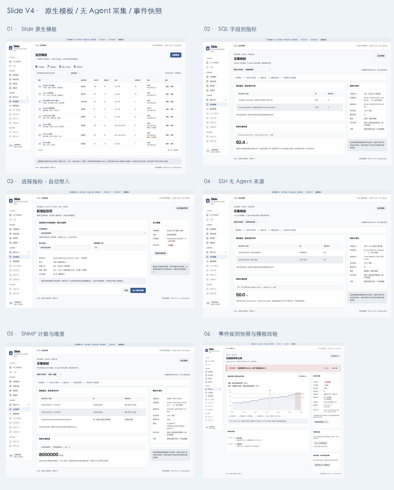

# GitHub 方案交接材料

整理日期：2026-10-25。V4 设计日期：2026-10-22。

本资料分支仅发布方案、独立原型与已有验证证据，不是生产功能发布。仓库 main 未因本次交接而合并或修改；后续实施前应重新核查当时真实代码和运行环境。

## 权威材料

- [当前版本项目范围](../../docs/slide/requirements/current-version-scope.md)
- [完整优化方案（含 A01–A22、P0–P4、资源详情澄清）](../../docs/superpowers/specs/2026-10-22-monitoring-operations-optimization-design.md)
- [AI 工作空间体验设计](../../docs/superpowers/specs/2026-10-22-ai-workspace-experience-review.md)
- [输入负担排查与验收](../../docs/superpowers/specs/2026-10-22-input-burden-audit.md)
- [原型说明与本地运行命令](README.md)
- [27 张 V4 截图](GALLERY.md)
- [V4 原型验证记录](VALIDATION.md)
- [原型源码](prototype/main.ts)

## 必须遵守的解释

1. 三类资源“详情”的简化弹窗仅是入口占位。保留现有 Slide 完整详情与专业功能；先盘点现有内容，提交差异表与三类完整详情原型，再进入相应页面开发。不能按简化弹窗删减功能。
2. 以 V4 和 2026-10-25 详情澄清为当前决策；历史研究中关于 Zabbix 兼容或旧导航的建议不作为实施要求。
3. 不装目标侧采集 Agent；不做 Zabbix 文件导入/转换、表达式兼容或 Agent/Proxy 集成。现有 AI Agent 运行时保持其职责。
4. 原型数据、采集、通知、审批角色、执行与恢复均为本地样例。截图、按钮、类型声明不代表生产能力已经实现。
5. 2026-10-22 的验证记录仅证明当时独立原型行为。本次发布补充文档与可访问材料，没有重做生产功能验收；历史 source-checks 中的日期、HEAD 与哈希保留原值，不冒充新版本验证。
6. 本资料快照包括当前 V4 源码、截图和 V3 验证文字；未打包旧版全部截图/构建及研究环境。缺失的历史附属材料不构成实施依赖。真实业务验收必须重新执行。
7. 原型源码从资料分支检出、安装仓库依赖后，按 README 命令运行。127.0.0.1 链接仅指阅读者自己启动的本地服务，不是公共在线演示。
8. 其他既有 GitHub Issue 如涉及相同采集、历史身份、阈值或调查预算，实施前应关联并复用其结论，避免重复实现。

资料分支基于发布时获取的 origin/main，仅追加本方案材料。原型最初核查基线为 45fe437b；后续业务实现不得将该旧基线当作最新现状。
